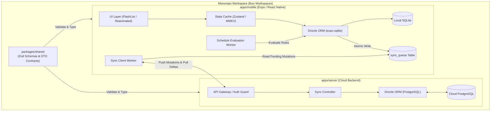
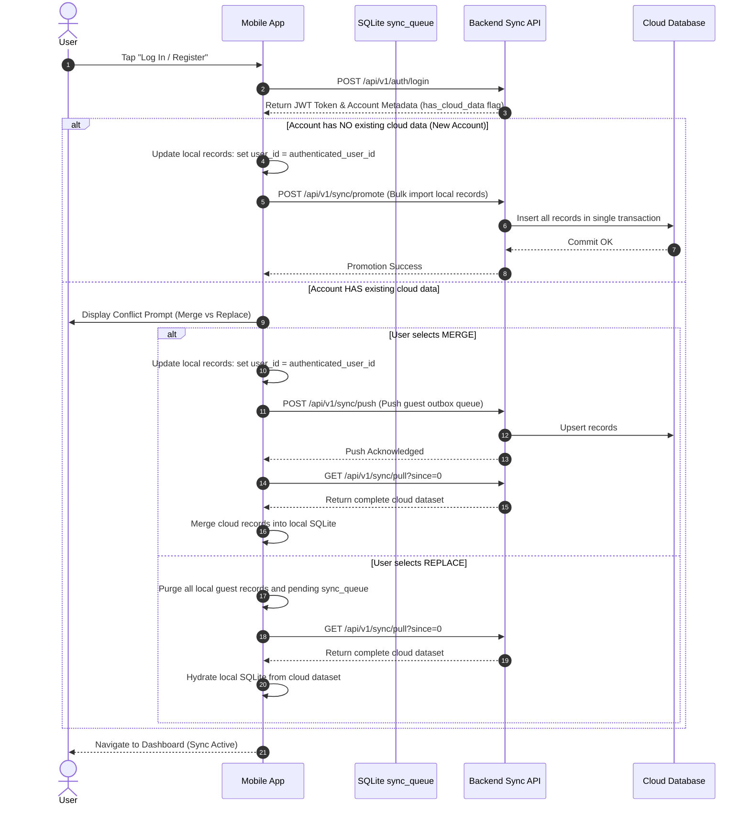
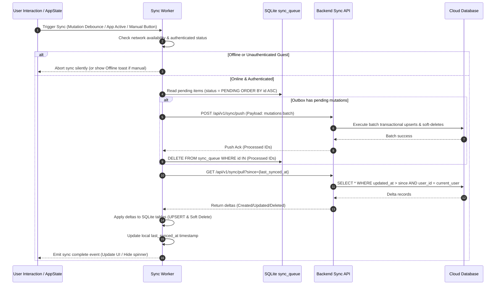
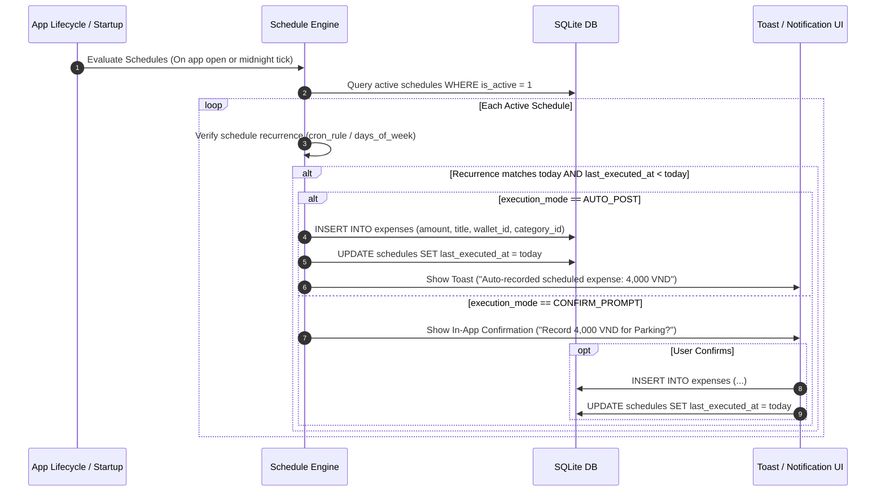

# Guest Mode and Offline-First Synchronization Architecture

---

## Overview & Context

OpenSpend supports both unauthenticated guest users and authenticated cloud-synced accounts. Guest users store all financial transactions locally on-device without requiring an internet connection or registration. When a guest user decides to create an account or log in, their local financial data is promoted and synchronized to the cloud backend.

### Problem Statement & Key Requirements

1. **Guest Isolation & Zero-Friction Cold Start**: Users must be able to immediately manage wallets and record expenses/incomes offline with zero network dependency.
2. **Lossless Account Promotion & Conflict Resolution**: Converting a guest session into an authenticated account must safely resolve potential conflicts if the account already contains remote cloud records (offering merge or replace strategies).
3. **Hybrid Background & Manual Synchronization**: Synchronization must run automatically in the background (debounced after mutations or when the app becomes active) and also support on-demand manual triggers (pull-to-refresh / sync button).
4. **Sub-Cent Financial Precision**: Bank wallets and investments often require fractional currency decimals (e.g., fractional interests, foreign exchange). The system must eliminate IEEE-754 floating-point rounding errors.
5. **Flexible Scheduled Transactions**: Recurring expenses (such as daily parking or commute fares) must support scheduled rules with configurable execution policies (`AUTO_POST` for automatic ledger entries or `CONFIRM_PROMPT` for manual confirmation before debiting).

### Learnings from Moonee Backup Analysis

Analysis of the legacy Moonee data archive (`moonee-backup-latest.zip`) identified architectural patterns to adopt and avoid:

- **Adopted**: Time-ordered partitioning for data backups, integer/fixed-point minor unit representation for currencies, and soft-delete audit records for change tracking.
- **Pruned (Anti-Patterns)**: Multi-layer accounting structures (`items` $\rightarrow$ `ledgerEvents` $\rightarrow$ `accountPostings`), unused speculative tables (wealth profiles, cart sessions, lending goals), and terminology drift. All domain terms are standardized strictly against `CONTEXT.md` (`Wallet`, `Expense`, `Income`, `Category`).

---

## Architecture

### System Context

### Storage & Identification Architecture

1. **Primary Key Strategy (UUID v7)**: Every entity (`Wallet`, `Expense`, `Income`, `Category`, `Transfer`, `Schedule`) generates a client-side UUID v7 identifier upon creation. UUID v7 embeds millisecond Unix timestamps in the high 48 bits, providing strict chronological ordering for SQLite B-tree clustering and distributed synchronization without ID collisions.
2. **Monetary Decimal Representation**: Currency values are persisted as exact fixed-point strings (`TEXT` in SQLite / `DECIMAL(18, 4)` in PostgreSQL). Arithmetic operations must use arbitrary-precision decimal libraries (`decimal.js` or `big.js`) to guarantee exact balance tracking without floating-point inaccuracies.
3. **Symbol References**:
   - `WalletEntity` in `src/modules/wallets/wallet.entity.ts`
   - `ExpenseEntity` in `src/modules/expenses/expense.entity.ts`
   - `IncomeEntity` in `src/modules/incomes/income.entity.ts`
   - `CategoryEntity` in `src/modules/categories/category.entity.ts`
   - `TransferEntity` in `src/modules/transfers/transfer.entity.ts`
   - `ScheduleEntity` in `src/modules/schedules/schedule.entity.ts`
   - `SyncQueueEntity` in `src/modules/sync/sync-queue.entity.ts`

4. **ORM and Persistence Technology (Drizzle ORM)**:
   - **Mobile**: Uses `drizzle-orm/expo-sqlite` wrapping `openDatabaseSync`. Schema definitions utilize `sqliteTable` with full compile-time typing, zero reflection overhead, and migration versioning via Drizzle Kit.
   - **Backend**: Uses `drizzle-orm/node-postgres` with `pgTable` definitions enforcing server-side relational constraints and indexing.
   - **Contracts**: Shared input validation and synchronization payloads are defined in `packages/shared` via Zod and inferred TypeScript types.
5. **Module Directory Layout (`apps/mobile/src/modules/*`)**:
   - `wallets/`: `wallet.schema.ts`, `wallet.service.ts`
   - `expenses/`: `expense.schema.ts`, `expense.service.ts`
   - `incomes/`: `income.schema.ts`, `income.service.ts`
   - `categories/`: `category.schema.ts`, `category.service.ts`
   - `transfers/`: `transfer.schema.ts`, `transfer.service.ts`
   - `schedules/`: `schedule.schema.ts`, `schedule.runner.ts`
   - `sync/`: `sync-queue.schema.ts`, `sync.worker.ts`, `sync.client.ts`

---

## Operational Flow

### 1. Guest-to-Account Promotion & Conflict Resolution

### 2. Hybrid Synchronization (Background & Manual)

### 3. Scheduled Transactions Execution

---

## Security & Reliability

1. **Authentication & Token Storage**:
   - Authenticated API requests require an `Authorization: Bearer <JWT>` header.
   - Refresh tokens and access tokens are secured using `expo-secure-store`.
   - Guest mode operates entirely locally with zero token footprint.
2. **Atomic Outbox Mutation Queue**:
   - Any local write operation modifying `wallets`, `expenses`, `incomes`, `categories`, `transfers`, or `schedules` must insert a corresponding mutation entry into `sync_queue` within the same SQLite transaction.
   - If SQLite crashes mid-operation, both the entity change and the outbox entry roll back together, preventing synchronization inconsistencies.
3. **Idempotent Upsert Semantics**:
   - Cloud push endpoints process mutations idempotently using UUID v7 primary keys. Re-transmitting an already processed mutation has no adverse side effects.
4. **Offline Resilience & Degradation**:
   - The application functions with 100% feature capability while offline. Network failures during background sync increment retry counters with exponential backoff (`Math.min(2 ** attempts * 1000, 30000)` ms) without interrupting the user interface.
5. **Conflict Resolution Policy**:
   - Synchronization applies Last-Write-Wins (LWW) resolution based on UTC ISO-8601 `updated_at` timestamps. Soft-deleted records (`deleted_at IS NOT NULL`) tombstone entities across clients.

---

## Domain Invariant Taxonomy (INV-N)

| Invariant ID   | Domain Invariant Name          | Formal Condition                                                                                                                     | Verification Test Strategy                                                                |
| :------------- | :----------------------------- | :----------------------------------------------------------------------------------------------------------------------------------- | :---------------------------------------------------------------------------------------- |
| **INV-SYNC-1** | Client ID Immutability         | `entity.id` remains invariant throughout guest and cloud-synced lifecycles.                                                          | Unit test verifying UUID v7 persistence before and after cloud promotion.                 |
| **INV-SYNC-2** | Atomic Outbox Commitment       | $\forall m \in \text{Mutations}, \Delta(\text{Entity}) \iff \Delta(\text{sync\_queue})$ within the same SQLite transaction.          | Rollback test confirming failure in entity write yields no dangling outbox row.           |
| **INV-SYNC-3** | Monotonic Queue Ordering       | Outbox processing order strictly satisfies $i < j \implies \text{created\_at}(i) \le \text{created\_at}(j)$.                         | Integration test processing outbox mutations against mock backend.                        |
| **INV-SYNC-4** | Transfer Balance Conservation  | $\Delta(\text{from\_wallet}) = -(\text{amount} + \text{fee}) \land \Delta(\text{to\_wallet}) = +\text{amount}$.                      | Test verifying bilateral balance adjustment on `transfers`.                               |
| **INV-SYNC-5** | Fixed-Point Monetary Precision | $\forall \text{amount}, \text{scale}(\text{amount}) \le 4 \land \text{amount} \in \mathbb{D}$ (no IEEE-754 binary float conversion). | Unit test verifying exact arithmetic on decimal fractions (e.g., `0.10 + 0.20 === 0.30`). |
| **INV-SYNC-6** | Schedule Execution Exclusivity | For any given schedule $s$, $\text{count}(\text{executions}(s, d)) \le 1$ for date $d$.                                              | Test verifying idempotency when schedule evaluation executes multiple times on same date. |
